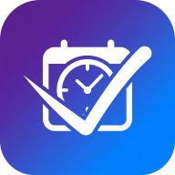
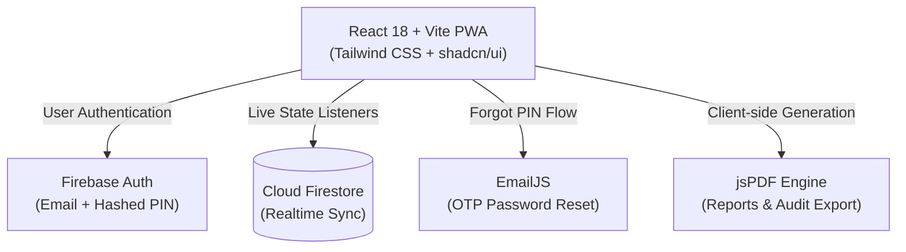
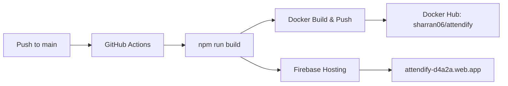

<div align="center">

  

  # Attendify

  ### 🎓 Intelligent Attendance & Campus Companion for Students

  <p align="center">
    A minimal, privacy-focused Progressive Web App designed to track lectures, calculate safe bunks, manage syllabus notes, and monitor academic attendance targets with zero friction.
  </p>

  <p align="center">
    <a href="https://attendify-d4a2a.web.app" target="_blank">
      
    </a>
  </p>

  <!-- Status & Tech Badges -->
  <p align="center">
    
    
    
    
    
    
    
    <a href="https://github.com/sharran-nk/Attendify/actions/workflows/attendify-ci-cd.yml">
      
    </a>
  </p>

  <br />

  

</div>

---

## ⚡ Highlights at a Glance

```
┌──────────────────────────────────────────────────────────────────────────┐
│                             ATTENDIFY HUB                                │
├──────────────────┬──────────────────┬──────────────────┬─────────────────┤
│  🎯 75% Bunk     │  📅 Timetable    │  📚 Subject Hub  │  📊 Instant PDF │
│     Calculator   │     Schedule     │     & PDF Notes  │     Export      │
│  Instant math to │  Matched with    │  CT1, CT2, &     │  Full monthly & │
│  reach or hold   │  active daily    │  semester marks  │  weekly audit   │
│  attendance      │  lectures        │  tracking        │  reports        │
└──────────────────┴──────────────────┴──────────────────┴─────────────────┘
```

---

## 📸 Application Showcase

<div align="center">

| 📱 Mobile First (PWA) | 💻 Desktop Dashboard |
| :---: | :---: |
|  |  |
| *Fluid touch gestures, fast PWA install* | *Wide-screen insights, timetable & subject matrix* |

</div>

---

## 🚀 Key Feature Modules

### 1. 🎯 Smart Attendance & Prediction Engine
* **Instant Dashboard Statistics**: Clear visual split of total, attended, absent, and percentage scores.
* **Non-Punitive Cancelled States**: Classes flagged as "Cancelled" are gracefully excluded from percentages.
* **Deterministic Safe-to-Bunk Math**:
  * Exact calculation of how many consecutive classes you can safely miss without breaching your cutoff.
  * Exact classes required to restore attendance if you fall below the configured target (50% – 90%, defaults to 75%).
* **Interactive Week Calendar**: Log multiple sessions in a single day, backfill previous weeks, and review attendance logs.

### 2. 📚 Subject & Academic Management
* **Color-Coded Badges**: Customize each subject with distinct accents for quick recognition.
* **Course Materials Hub**: In-app PDF upload and previewer for syllabus copies and lecture slide notes.
* **Internal Marks Breakdown**: Log and tally continuous assessments (CT1, CT2), mini-projects, and end-semester scores.

### 3. 📅 Schedule & Tasks
* **Timetable Mapping**: Synchronizes configured periods with real daily timeslots.
* **Photo Timetable View**: Upload your physical classroom timetable sheet and inspect it anytime in full-screen.
* **Academic Tasks**: Organize to-do items by deadline, priority, and one-click export to Google Calendar.

### 4. 🔒 Authentication & Cloud Sync
* **Email + Hashed PIN**: Fast, passwordless login using SHA-256 PIN security.
* **OTP Reset**: Seamless PIN retrieval flow delivered via EmailJS.
* **Real-Time Cloud Synchronization**: Firestore backed, instant live update across multiple devices.
* **PWA & Offline Readiness**: Service worker precaching, custom add-to-homescreen triggers, and configurable morning lecture alerts.

---

## 🛠️ Architecture & Tech Stack



| Domain | Tools & Technologies |
| :--- | :--- |
| **Frontend Core** | React 18, TypeScript, Vite 5, React Router v6 |
| **Styling & Motion** | Tailwind CSS, shadcn/ui (Radix Primitives), Framer Motion, Lucide Icons |
| **Cloud & Storage** | Firebase Authentication, Cloud Firestore |
| **Date & Documents** | `date-fns`, `jspdf`, `jspdf-autotable` |
| **Notifications & Mail**| Native Web Notification API, EmailJS SDK, Sonner Toasts |
| **DevOps & Container** | Docker (Multi-stage Node 22 + Nginx Alpine), GitHub Actions CI/CD |

---

## 📐 How Attendance Calculations Work

All calculations are **100% deterministic arithmetic** — transparent, predictable, and free from estimation algorithms.

Let:
- $a$ = Classes Attended
- $b$ = Classes Absent
- $T$ = Attendance Threshold (e.g., $75\%$)
- *(Cancelled lectures are automatically omitted from both $a$ and $b$)*

```
┌─────────────────────────────────┬────────────────────────────────────────────────────────┐
│ Metric                          │ Mathematical Formula                                   │
├─────────────────────────────────┼────────────────────────────────────────────────────────┤
│ Current Attendance (%)          │  Percentage = (a / (a + b)) × 100                      │
├─────────────────────────────────┼────────────────────────────────────────────────────────┤
│ Classes Needed to Reach Target  │  n = ⌈ (T(a + b) - 100a) / (100 - T) ⌉                 │
│                                 │  (returns 0 if current % >= T)                         │
├─────────────────────────────────┼────────────────────────────────────────────────────────┤
│ Safe Classes to Bunk            │  m = ⌊ (100a - T(a + b)) / T ⌋                         │
│                                 │  (returns 0 if current % < T)                          │
├─────────────────────────────────┼────────────────────────────────────────────────────────┤
│ If You Attend Next Class        │  Percentage = ((a + 1) / (a + b + 1)) × 100            │
├─────────────────────────────────┼────────────────────────────────────────────────────────┤
│ If You Miss Next Class          │  Percentage = (a / (a + b + 1)) × 100                  │
└─────────────────────────────────┴────────────────────────────────────────────────────────┘
```

---

## 🗂️ Project Directory Layout

```
attendify/
├── .github/workflows/        # Automated CI/CD (Build, Docker Hub Push, Firebase Deploy)
├── public/                   # PWA Manifest, App Icons & Brand Assets
├── src/
│   ├── components/
│   │   ├── attendance/       # PDF Report Generation & Export Modal
│   │   ├── auth/             # Login, ProtectedRoute & PIN Recovery Dialog
│   │   ├── dashboard/        # Overall Attendance Ring, Timetable & Today's Classes
│   │   ├── layout/           # PageContainer & iOS Glass TabBar
│   │   ├── pwa/              # Native Web Install Prompts
│   │   └── ui/               # shadcn / Radix UI design tokens
│   ├── contexts/             # AppContext (Firestore Sync) & AuthContext
│   ├── hooks/                # PWA Install & Morning Reminder Hooks
│   ├── lib/                  # Firebase Client & Timetable Generators
│   ├── pages/                # Dashboard, Subjects, Calendar, Tasks, Settings, Login
│   ├── types/                # Domain Types (attendance.ts, user.ts)
│   └── utils/                # Calculation Formulas & jsPDF Document Layouts
├── Dockerfile                # Multi-stage production container
├── nginx.conf                # High-performance SPA routing & caching
├── firebase.json             # Firebase Hosting rewrites & rules
└── firestore.rules           # Security rules for Firestore collections
```

---

## ⚙️ Getting Started & Local Development

### 1. Clone & Install Dependencies
```bash
git clone https://github.com/sharran-nk/Attendify.git
cd Attendify
npm install
```

### 2. Environment Variables Configuration
Create a `.env` file in the root directory:
```env
# Firebase Configuration
VITE_FIREBASE_API_KEY=your_api_key
VITE_FIREBASE_AUTH_DOMAIN=your_project.firebaseapp.com
VITE_FIREBASE_PROJECT_ID=your_project_id
VITE_FIREBASE_STORAGE_BUCKET=your_project.appspot.com
VITE_FIREBASE_MESSAGING_SENDER_ID=your_sender_id
VITE_FIREBASE_APP_ID=your_app_id

# EmailJS Configuration (for PIN Recovery)
VITE_EMAILJS_SERVICE_ID=your_service_id
VITE_EMAILJS_TEMPLATE_ID=your_template_id
VITE_EMAILJS_PUBLIC_KEY=your_public_key
```

### 3. Launch Development Server
```bash
npm run dev
```
Visit `http://localhost:5173` to view the app.

---

## 📦 Containerization & Deployment

### Run with Docker

```bash
# Build production container image
docker build -t attendify:latest .

# Run container on port 8080
docker run -d -p 8080:80 --name attendify-app attendify:latest
```

### CI/CD Deployment Flow



Every push to `main` triggers automated verification, Docker image deployment to Docker Hub, and live static asset deployment to Firebase Hosting.

---

## 👤 Author

**Sharran Nandakumar**
* **GitHub**: [@sharran-nk](https://github.com/sharran-nk)
* **Application**: [Attendify on the Web](https://attendify-d4a2a.web.app)
