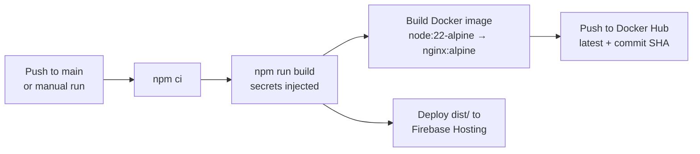

<div align="center">

# Attendify

**Attendance tracker and companion app for college students, built as an installable PWA.**

[**Live app →**](https://attendify-d4a2a.web.app)


[](https://github.com/sharran-nk/Attendify/actions/workflows/attendify-ci-cd.yml)

</div>

---

## Screenshots

| Mobile | Desktop |
| :----: | :-----: |
| <!-- TODO: add mobile screenshot --> | <!-- TODO: add desktop screenshot --> |

## Features

### Attendance
- **Dashboard** with a greeting, overall attendance (total, attended, missed, %), and today's classes from your timetable.
- Mark each class **Present**, **Absent** or **Cancelled**. Cancelled classes don't count toward the percentage.
- **Predictions** (simple deterministic maths):
  - "Attend the next *N* classes to reach 75%"
  - "Safe to miss *N* classes"
  - What your percentage becomes if you attend or miss the next class
  - Target threshold configurable from **50–90%** (default **75%**)
- **Attendance calendar**: week view; add or remove present/absent entries for any day, with support for several classes per day.

### Academics
- **Subjects**: per-subject attendance, instructor, credits, colour, notes, PDF course materials, and exam marks (CT1, CT2, Project, End Sem) with totals.
- **Timetable**: weekly slot-based timetable, plus an uploaded timetable image with a fullscreen viewer.
- **Tasks**: assignments with due dates/times, filters (all / pending / completed), and an "Add to Google Calendar" link.
- **Reports**: export attendance to PDF (jsPDF + jspdf-autotable).

### Account & Sync
- **Sign-in with email + PIN** via Firebase Authentication. PINs are stored as SHA-256 hashes.
- **Forgot PIN** flow through EmailJS.
- **Real-time cloud sync** with Cloud Firestore, plus a one-time migration from old localStorage data.

### App experience
- **Installable PWA** with an in-app install prompt (also covers iOS).
- **Daily attendance reminder** via browser notifications (time is configurable).
- **Light / Dark / System** themes.
- **Share button**: native share sheet on mobile; on desktop it copies a message and downloads an image.

## Tech Stack

| Area | Technology |
| --- | --- |
| Framework | React 18, TypeScript, Vite 5 |
| Styling & UI | Tailwind CSS, shadcn/ui (Radix UI), Framer Motion, Lucide icons, Sonner |
| Backend services | Firebase (Auth, Firestore, Hosting) |
| Utilities | date-fns, jsPDF, EmailJS |
| PWA | vite-plugin-pwa |
| Deployment | Docker + Nginx, GitHub Actions |

## Getting Started

**Requirements:** Node.js 18+ (CI uses Node 22).

```bash
# 1. Clone
git clone https://github.com/sharran-nk/Attendify.git
cd Attendify

# 2. Install
npm install

# 3. Configure environment (see below)
touch .env

# 4. Run
npm run dev
```

### Environment variables

Create a `.env` file in the project root. **Never commit it.**

```env
VITE_FIREBASE_API_KEY=
VITE_FIREBASE_AUTH_DOMAIN=
VITE_FIREBASE_PROJECT_ID=
VITE_FIREBASE_STORAGE_BUCKET=
VITE_FIREBASE_MESSAGING_SENDER_ID=
VITE_FIREBASE_APP_ID=
VITE_EMAILJS_SERVICE_ID=
VITE_EMAILJS_TEMPLATE_ID=
VITE_EMAILJS_PUBLIC_KEY=
```

### Scripts

| Command | Description |
| --- | --- |
| `npm run dev` | Start the dev server |
| `npm run build` | Production build |
| `npm run preview` | Preview the production build locally |
| `npm run lint` | Run the linter |

## Firebase Setup

1. Create a project in the [Firebase Console](https://console.firebase.google.com/).
2. Register a web app and copy its config values into the `VITE_FIREBASE_*` variables in `.env`.
3. Go to **Authentication → Sign-in method** and enable **Email/Password**.
4. Go to **Firestore Database** and create a database.
5. Deploy the security rules (defined in `firestore.rules`):

   ```bash
   firebase deploy --only firestore:rules
   ```

### Firestore data model (per user)

```
users/{uid}                 → profile, pinHash
  ├─ subjects
  ├─ attendance
  ├─ tasks
  ├─ coursePlans
  ├─ timetable
  └─ settings/current
```

## Run with Docker

The image is a multi-stage build (`node:22-alpine` build → `nginx:alpine` serve). Vite variables are baked in at build time, so pass them as build args.

### Pull the published image

```bash
docker pull sharran06/attendify
```

> [!NOTE]
> Published images are built in CI with the project's own Firebase/EmailJS values. To run against your own Firebase project, build the image yourself as below.

### Build and run locally

```bash
docker build \
  --build-arg VITE_FIREBASE_API_KEY=... \
  --build-arg VITE_FIREBASE_AUTH_DOMAIN=... \
  --build-arg VITE_FIREBASE_PROJECT_ID=... \
  --build-arg VITE_FIREBASE_STORAGE_BUCKET=... \
  --build-arg VITE_FIREBASE_MESSAGING_SENDER_ID=... \
  --build-arg VITE_FIREBASE_APP_ID=... \
  --build-arg VITE_EMAILJS_SERVICE_ID=... \
  --build-arg VITE_EMAILJS_TEMPLATE_ID=... \
  --build-arg VITE_EMAILJS_PUBLIC_KEY=... \
  -t attendify .

docker run -p 8080:80 attendify
```

Open <http://localhost:8080>.

### Docker Compose

```bash
docker compose up --build
```

<!-- TODO: confirm how docker-compose.yml picks up the VITE_* values (e.g. from .env) and document it here -->

## CI/CD Pipeline

Defined in `.github/workflows/attendify-ci-cd.yml`. It runs on every push to `main` and can also be triggered manually.

1. **Build**: `npm ci` and `npm run build`, with Firebase and EmailJS secrets injected.
2. **Docker**: build and push the multi-stage image to Docker Hub, tagged `latest` and with the commit SHA.
3. **Deploy**: publish `dist/` to Firebase Hosting (live channel, project `attendify-d4a2a`).



### Required GitHub secrets

| Secret | Purpose |
| --- | --- |
| `VITE_FIREBASE_API_KEY` | Firebase config |
| `VITE_FIREBASE_AUTH_DOMAIN` | Firebase config |
| `VITE_FIREBASE_PROJECT_ID` | Firebase config |
| `VITE_FIREBASE_STORAGE_BUCKET` | Firebase config |
| `VITE_FIREBASE_MESSAGING_SENDER_ID` | Firebase config |
| `VITE_FIREBASE_APP_ID` | Firebase config |
| `VITE_EMAILJS_SERVICE_ID` | EmailJS config |
| `VITE_EMAILJS_TEMPLATE_ID` | EmailJS config |
| `VITE_EMAILJS_PUBLIC_KEY` | EmailJS config |
| `DOCKERHUB_USERNAME` | Docker Hub login |
| `DOCKERHUB_TOKEN` | Docker Hub login |
| `FIREBASE_SERVICE_ACCOUNT_ATTENDIFY_D4A2A` | Firebase Hosting deploy |

## Project Structure

```
src/
  components/   attendance, auth, dashboard, layout, pwa, ui
  contexts/     AuthContext, AppContext (Firestore listeners & write actions)
  hooks/        useAttendanceReminder, usePWAInstall, ...
  lib/          firebase.ts, defaultTimetable.ts, utils.ts
  pages/        Dashboard, Subjects, AttendanceCalendar, Tasks, Settings, Login
  types/        attendance.ts, user.ts
  utils/        attendance.ts (calculations), exportUtils.ts (PDF export)
Dockerfile
docker-compose.yml
nginx.conf
firebase.json
firestore.rules
.github/workflows/attendify-ci-cd.yml
```

## How Attendance Is Calculated

Everything is plain arithmetic, with no AI or estimation involved.

Let **a** = classes attended, **b** = classes absent, **T** = target percentage (50–90, default 75).
Cancelled classes are excluded from both **a** and **b**.

**Current percentage**

```
percentage = a / (a + b) × 100
```

**Classes needed to reach the target** (smallest whole *n* such that attending the next *n* classes gets you to **T**)

```
(a + n) / (a + b + n) ≥ T / 100
n = ceil( (T × (a + b) − 100 × a) / (100 − T) )      // 0 if already at or above T
```

**Safe to miss** (largest whole *m* such that missing the next *m* classes keeps you at or above **T**)

```
a / (a + b + m) ≥ T / 100
m = floor( (100 × a − T × (a + b)) / T )             // 0 if already below T
```

**Next-class outcomes**

```
if you attend: (a + 1) / (a + b + 1) × 100
if you miss:    a      / (a + b + 1) × 100
```

> [!NOTE]
> The calculation logic lives in `src/utils/attendance.ts`.

## Author

**Sharran Nandakumar** · [GitHub](https://github.com/sharran-nk)
